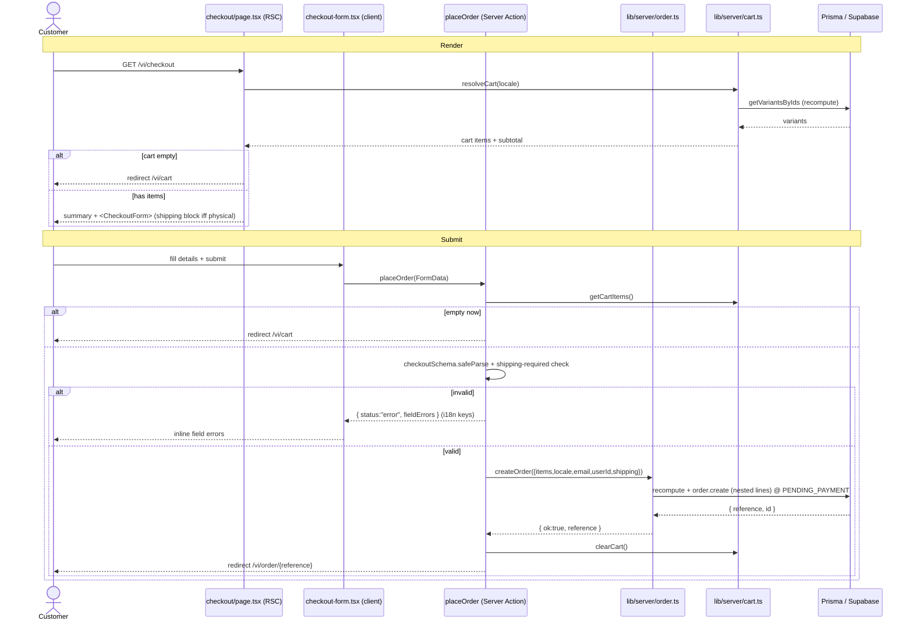

# Story 3.2: Checkout and order creation

> **Epic:** 3 · **FR:** FR-5, FR-6, FR-7 · **AD:** AD-8, AD-10, AD-11, AD-14 (+ AD-2, AD-5, AD-7) · **Status:** Done — static gates + runtime green · **Branch:** `checkout-flow` (merged to `main`) · **Commit:** `cf7348c`
> **Source story:** `_bmad-output/planning-artifacts/.../epics.md` → Story 3.2 · **Impl artifact:** `_bmad-output/implementation-artifacts/3-2-checkout-and-order-creation.md`

**As a** Customer, **I want** to enter my details and place my cart as an order, **so that** I get an order reference I can track — even as a guest.

This is the first *transactional* story: it turns the cookie-backed cart (Story 3.1) into a persisted `Order` at `PENDING_PAYMENT`. Payment itself (VietQR / COD) is deliberately deferred to 3.3+ — checkout ends on an order-summary page with a "payment next" note.

---

## 1. Gaps & Decisions (Resolved)

| ID | Area | Decision | Status |
|----|------|----------|--------|
| D1 | Security | The client cart total is **never trusted**. `createOrder` re-fetches published variants and recomputes subtotal, shipping, and grand total from the DB (AD-10). The cookie only carries `{variantId, qty}`. | ✅ Resolved |
| D2 | Data | Order money is **decomposed** (`subtotalVnd` / `shippingFeeVnd` / `discountVnd` / `grandTotalVnd`), and each `OrderLine` **snapshots** unit price + format + buyer-locale product name (AD-11), so later operator edits never re-price history. `variantId` is a soft FK (`onDelete: SetNull`). | ✅ Resolved |
| D3 | Fulfilment | Shipping applies **iff** any line is `PRINT` (AD-8); shipping address fields are required only then. Digital lines are pinned to `qty = 1`. | ✅ Resolved |
| D4 | Guest lookup | Orders are keyed by a short, unambiguous 8-char `reference` (alphabet excludes O/0/I/1) for guest lookup by reference + email (AD-14). Collisions retry up to 5× on Prisma `P2002`. | ✅ Resolved |
| D5 | Scope | No payment in this story. Order is created at `PENDING_PAYMENT`; the summary page shows a "payment next" placeholder. Email confirmation deferred to 3.5 (needs Resend). | ✅ Resolved |

---

## 2. Architecture

### 2.1 Source-tree layout

```text
prisma/
├── schema.prisma                                       # (mod) enum OrderStatus; model Order; model OrderLine;
│                                                        #       + orders Order[] on User, orderLines on ProductVariant
└── migrations/20260807081813_add_orders/migration.sql  # (new) Order/OrderLine tables + OrderStatus enum

lib/
├── server/
│   ├── order.ts                                         # (new) Order aggregate: createOrder, getOrderByReference
│   └── cart.ts                                          # (mod) + getCartItems() raw {variantId,qty}[] for recompute
└── validation/
    └── checkout-schemas.ts                              # (new) checkoutSchema + SHIP_FIELDS (i18n-key messages)

app/[locale]/
├── checkout/
│   ├── page.tsx                                         # (new) RSC — server-computed summary + details form; redirects if cart empty
│   ├── checkout-form.tsx                                # (new) "use client" — useActionState(placeOrder); shipping block iff hasPhysical
│   └── actions.ts                                       # (new) "use server" — placeOrder: validate → createOrder → clearCart → redirect
├── order/[reference]/
│   └── page.tsx                                         # (new) RSC — order summary by reference (guest lookup)
└── cart/
    └── page.tsx                                         # (mod) disabled "checkout soon" → real <Link href="/checkout">

messages/
├── en.json                                             # (mod) Checkout namespace (~38 keys, incl. status_* / format_*)
└── vi.json                                             # (mod) Checkout namespace (Vietnamese, default + fallback)
```

Reused unchanged: `getVariantsByIds` (`lib/server/product.ts`, published-only, from Story 2.4), `getStoreSettings` (`lib/server/settings.ts`), `pickLocalized` + `formatVnd` (`lib/format.ts`), `auth()` (`auth.ts`).

### 2.2 Data model

| Model / Enum | Table | Key fields | Notes |
|--------------|-------|------------|-------|
| `OrderStatus` | — (enum) | `PENDING_PAYMENT PAID PROCESSING SHIPPED COMPLETED CANCELLED` | Fixed status machine (AD-3). Orders created at `PENDING_PAYMENT`. |
| `Order` | `Order` | `reference @unique`, `status @default(PENDING_PAYMENT)`, `locale`, `customerEmail`, `userId?` (→ User, `SetNull`), decomposed money `Int`, `ship*` nullable | Transactional aggregate root. Money integer VND (AD-5). `userId` set when signed in; email always present for guest lookup (AD-14). `@@index([userId])`. |
| `OrderLine` | `OrderLine` | `orderId` (→ Order, `Cascade`), `variantId?` (→ ProductVariant, `SetNull`), `productName`, `format`, `unitPriceVnd`, `qty`, `lineTotalVnd` | Snapshots the buy (AD-11); soft link to variant so history never live-joins. `@@index([orderId])`. |

Migration: `prisma/migrations/20260807081813_add_orders/`.

### 2.3 Layer responsibilities

| Layer | Owns (for this story) | File(s) |
|-------|-----------------------|---------|
| RSC page | reads cart + settings, renders summary; renders the client form; guest order lookup | `checkout/page.tsx`, `order/[reference]/page.tsx` |
| Server Action | `getLocale`/`auth` → `getCartItems` (redirect if empty) → determine `hasPhysical` → Zod validate → `createOrder` → `clearCart` → `redirect` | `checkout/actions.ts` (`placeOrder`) |
| `lib/server` service | **all money math + snapshots + reference generation + order create** (AD-10/AD-11) | `lib/server/order.ts` |
| Cart service | reads cart cookie as raw `{variantId, qty}[]`; clears cookie on success | `lib/server/cart.ts` |
| Data access | Prisma singleton (PrismaPg → Supabase) | `lib/server/db.ts` |

### 2.4 Business rules & invariants

| Rule | Source | Enforced in |
|------|--------|-------------|
| Money recomputed from DB; client total never trusted | AD-10 | `lib/server/order.ts` (`createOrder`) |
| Each line snapshots price + format + buyer-locale name | AD-11 | `lib/server/order.ts` (line 85–99) |
| Digital variant qty forced to 1 | AD-8 | `lib/server/order.ts` (`qty = v.format === "DIGITAL" ? 1 : …`) |
| Shipping fee + address required iff any physical line | AD-8, FR-7 | `lib/server/order.ts` (`hasPhysical`) + `checkout/actions.ts` |
| Prices/totals are integer VND | AD-5 | schema `Int` fields + `order.ts` arithmetic |
| Product name stored in buyer locale | AD-7 | `pickLocalized(input.locale, …)` in `order.ts` |
| Email + phone shape validated | FR-6 | `lib/validation/checkout-schemas.ts` |
| Unique guest-lookup reference (retry on clash) | AD-14 | `order.ts` (`generateOrderReference` + P2002 retry) |
| Only `lib/server` touches Prisma | AD-2 | `order.ts` is the sole DB caller; action/page delegate |

### 2.5 Sequence diagram



### 2.6 Result / error flows

| Scenario | Outcome | Where |
|----------|---------|-------|
| Cart empty (at render or submit) | `redirect("/{locale}/cart")` | `checkout/page.tsx`, `checkout/actions.ts` |
| Field validation fails (email/shipping) | `{ status:"error", fieldErrors }` — values are i18n keys (`required`, `invalidEmail`) resolved by the client form | `checkout/actions.ts` |
| `createOrder` returns `empty-cart` | `redirect("/{locale}/cart")` | `checkout/actions.ts` |
| `createOrder` returns other error (e.g. `reference-generation-failed`) | `{ status:"error", formError:"genericError" }` | `checkout/actions.ts` |
| Success | `redirect("/{locale}/order/{reference}")` | `checkout/actions.ts` |
| Unknown reference on summary page | order-not-found panel (`Checkout.orderNotFound*`) | `order/[reference]/page.tsx` |

### 2.7 Convention compliance (AD / AR / UX-DR)

| Rule | Status | Note |
|------|--------|------|
| AD-2 — only `lib/server` imports Prisma | ✅ | Page + action delegate; `order.ts`/`cart.ts` are the only DB callers. |
| AD-5 — integer VND end-to-end | ✅ | Schema `Int`, `order.ts` integer math, `formatVnd` for display. |
| AD-7 — per-locale content, VN fallback | ✅ | Line `productName` snapshot via `pickLocalized`; `Checkout` ns in both messages files. |
| AD-8 — variant format drives fulfilment | ✅ | `hasPhysical` gates shipping + address; digital `qty` pinned to 1. |
| AD-10 — Order carries its own decomposed money, recomputed | ✅ | `createOrder` recomputes; four money columns persisted. |
| AD-11 — OrderLine snapshots the purchase | ✅ | name/format/unitPrice snapshotted; `variantId` soft FK. |
| AD-14 — guest lookup by reference | ✅ | 8-char unambiguous reference; `getOrderByReference`. |

### 2.8 Components & i18n keys

| Component | Kind | File |
|-----------|------|------|
| `CheckoutForm` | client (`useActionState`) | `checkout/checkout-form.tsx` |
| `TextareaField` | reused (from 2.1) | `components/form/textarea-field.tsx` |

**i18n namespace `Checkout`** added to `messages/en.json` + `messages/vi.json` — includes: `title`, `detailsHeading`, `summaryHeading`, `shippingHeading`, `emailLabel`/`nameLabel`/`phoneLabel`/`addressLabel`/`cityLabel`, `required`, `invalidEmail`, `genericError`, `digitalOnlyNote`, `placeOrder`, `subtotal`/`shipping`/`free`/`grandTotal`, `orderTitle`/`orderPlaced`/`statusLabel`/`shipTo`, `status_*` (6 order statuses), `format_PRINT`/`format_DIGITAL`, `paymentNext*`, `orderNotFound*`, `backToShop`.

---

## 3. Tasks (checklist)

| ID | Task | File |
|----|------|------|
| T01 | Add `OrderStatus`, `Order`, `OrderLine` + back-relations; migrate | `prisma/schema.prisma`, `prisma/migrations/20260807081813_add_orders/` |
| T02 | `createOrder` + `getOrderByReference` (recompute, snapshot, reference) | `lib/server/order.ts` |
| T03 | `getCartItems()` raw accessor | `lib/server/cart.ts` |
| T04 | `checkoutSchema` + `SHIP_FIELDS` (i18n-key messages) | `lib/validation/checkout-schemas.ts` |
| T05 | Checkout RSC page (summary + redirect-if-empty) | `app/[locale]/checkout/page.tsx` |
| T06 | `placeOrder` Server Action | `app/[locale]/checkout/actions.ts` |
| T07 | `CheckoutForm` client component | `app/[locale]/checkout/checkout-form.tsx` |
| T08 | Order summary page (guest lookup) | `app/[locale]/order/[reference]/page.tsx` |
| T09 | Enable Checkout link on cart | `app/[locale]/cart/page.tsx` |
| T10 | `Checkout` i18n namespace (en + vi) | `messages/{en,vi}.json` |

- [x] T01 [x] T02 [x] T03 [x] T04 [x] T05 [x] T06 [x] T07 [x] T08 [x] T09 [x] T10

---

## 4. Verification

- **Static gates:** `npx tsc --noEmit` · `npx eslint .` · `npm run build` — all green (build lists `/[locale]/checkout` and `/[locale]/order/[reference]` routes).
- **Runtime (cookie-jar curl + browser):** add a print variant → `/vi/checkout` shows shipping block + shipping fee; submit with missing fields → inline i18n errors; valid submit → redirect to `/vi/order/{REF}` with a persisted `PENDING_PAYMENT` order; cart cookie cleared. Digital-only cart → no shipping block, `digitalOnlyNote`, `qty` fixed to 1.
- **Server-truth check:** tampering with the cart cookie's prices has no effect — totals come from the DB recompute.

---

## 5. Dev Agent Record — File List

| File | Created / Modified | Role |
|------|--------------------|------|
| `prisma/schema.prisma` | Modified | `OrderStatus` enum, `Order` + `OrderLine` models, back-relations on `User`/`ProductVariant` |
| `prisma/migrations/20260807081813_add_orders/migration.sql` | Created | Order/OrderLine tables + enum |
| `lib/server/order.ts` | Created | Order aggregate: `createOrder`, `getOrderByReference` (recompute, snapshot, reference gen) |
| `lib/server/cart.ts` | Modified | Added `getCartItems()` raw accessor |
| `lib/validation/checkout-schemas.ts` | Created | `checkoutSchema`, `SHIP_FIELDS` (i18n-key messages) |
| `app/[locale]/checkout/page.tsx` | Created | RSC checkout page (summary + details form, redirect-if-empty) |
| `app/[locale]/checkout/checkout-form.tsx` | Created | Client form (`useActionState` → `placeOrder`) |
| `app/[locale]/checkout/actions.ts` | Created | `placeOrder` Server Action |
| `app/[locale]/order/[reference]/page.tsx` | Created | Order summary by reference (guest lookup) |
| `app/[locale]/cart/page.tsx` | Modified | Real Checkout link |
| `messages/en.json` | Modified | `Checkout` namespace |
| `messages/vi.json` | Modified | `Checkout` namespace (Vietnamese) |

**Not in scope (later stories):** payment — VietQR/payOS (3.3), COD (3.4); order confirmation email (3.5, needs Resend); digital download delivery on `PAID` (3.6/3.7); customer order history list on `/account` (uses the `Order.userId` link already in place).
