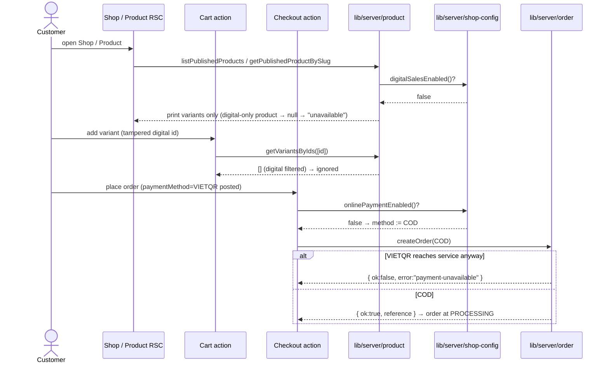

# Story 3.8: Interim prints-only, COD-only shop

> **Epic:** 3 · **FR:** FR-8 (COD path), FR-2, FR-4 · **AD:** AD-4, AD-8 (+ AD-1, AD-2, AD-10) · **Status:** Implemented — static gates green; runtime walk blocked (DB unreachable, see §4) · **Branch:** `cod-and-orders` (or a new `interim-shop-guard`) · **Commit:** _pending_
> **Source story:** `_bmad-output/planning-artifacts/epics.md` → Story 3.8 · **Why:** `_bmad-output/planning-artifacts/sprint-change-proposal-2026-10-29.md` §2.4

**As the** Operator, **I want** the live shop to offer only what I can actually fulfil today, **so that** no visitor places an order that can never complete.

Today two paths in the reachable shop are dead ends:
1. Checkout offers **VietQR**, but no payment provider exists (3.3 is deferred), so those orders sit at *Pending Payment* forever.
2. A cart with a **Digital Download** can't use COD (AD-8), so it is forced onto VietQR. Even if paid, nothing would deliver the file (3.6 is deferred).

This story adds two server-side switches, both **off by default**. While they're off, the shop sells **Physical Prints only, by COD only**. Stories 3.3 and 3.6 turn them on when they ship.

---

## 1. Gaps & Decisions

| ID | Area | Decision | Status |
|----|------|----------|--------|
| D1 | Config | **Two env flags, not one:** `SHOP_ONLINE_PAYMENT_ENABLED` (flipped by 3.3) and `SHOP_DIGITAL_SALES_ENABLED` (flipped by 3.6). 3.3 and 3.6 ship separately: VietQR for prints is valid without digital. Read only in a new `lib/server/shop-config.ts`. Only the exact value `"true"` enables; unset or anything else = **off** (safe default). | ✅ Resolved |
| D2 | Config | **Digital sales require online payment.** `digitalSalesEnabled()` = digital flag **AND** online-payment flag. COD can never pay for digital (AD-8), so digital-on with payment-off would recreate dead end #2. | ✅ Resolved |
| D3 | Config | **Env var, not an admin toggle.** These are capability switches tied to deployed code (payOS, delivery), not something the Operator should flip; there is no admin UI. A `StoreSetting` toggle is easy to add later if wanted. | ✅ Resolved |
| D4 | Architecture | **One choke point for digital.** Filter `DIGITAL` inside `lib/server/product.ts`: `getVariantsByIds` (used by cart add/resolve, checkout and `createOrder`) plus the two storefront reads. Every downstream path inherits the rule with no per-caller checks (AD-2). | ✅ Resolved |
| D5 | UX | A **digital-only Product** is treated as unavailable: it is not listed in Shop, and its detail URL shows the existing calm "This piece isn't available right now" state (not a 404). A **mixed Product** shows its print sizes only. Shop card tags become "Print" for it. | ✅ Resolved |
| D6 | UX | Checkout with online payment off: **only the COD option renders** (pre-selected), plus a one-line note "Payment is cash on delivery for now." The digital-cart COD warning disappears naturally, since digital lines can't be in the cart. | ✅ Resolved |
| D7 | Security | **Server re-guards, client is cosmetic.** `placeOrder` forces `COD` when online payment is off. `createOrder` rejects `VIETQR` with `payment-unavailable` if it somehow arrives. A tampered cookie with a digital variant id is silently dropped by the choke point. | ✅ Resolved |
| D8 | Data | **No schema change, no migration.** Existing data is untouched: digital variants stay in the DB and in admin (the Operator can still prepare them). Existing *Pending Payment* VietQR orders, if any, stay as they are. The Operator handles them by hand (cancel is 4.3, deferred). Old cart cookies holding digital lines lose those lines silently on next render. | ✅ Resolved |
| D9 | Scope | **Admin is not changed.** Admin product editing, order views and the watermark pipeline keep working regardless of the flags. *Optional:* a one-line hint in the product editor ("Digital sales are currently off; digital variants are hidden from the shop"). **Included** at the owner's request: a `text-pending` note inside each digital variant block. | ✅ Resolved |

---

## 2. Architecture

### 2.1 Source-tree layout

```text
lib/
└── server/
    ├── shop-config.ts                   # (new) onlinePaymentEnabled() · digitalSalesEnabled() — sole reader of the 2 env flags
    ├── product.ts                       # (mod) filter DIGITAL in getVariantsByIds · listPublishedProducts · getPublishedProductBySlug
    └── order.ts                         # (mod) createOrder: reject VIETQR when online payment is off → "payment-unavailable"

app/[locale]/checkout/
├── page.tsx                             # (mod) read onlinePaymentEnabled(); pass to form
├── checkout-form.tsx                    # (mod) render VietQR radio only when enabled; COD-only note
└── actions.ts                           # (mod) server-truth method: COD forced when online payment off

messages/
├── en.json                              # (mod) Checkout.codOnlyNote
└── vi.json                              # (mod) Checkout.codOnlyNote

.env.example                             # (mod) document both flags (default off)
```

### 2.2 Data model

None. No schema or migration changes.

### 2.3 Layer responsibilities

| Layer | Owns (for this story) | File(s) |
|-------|-----------------------|---------|
| Config | Reads the env flags; the only place `process.env.SHOP_*` appears | `lib/server/shop-config.ts` |
| `lib/server` service | Hides digital variants from every storefront/cart/order read; rejects VietQR in `createOrder` | `product.ts`, `order.ts` |
| Server Action | Resolves the payment method server-side (COD when payment is off) | `checkout/actions.ts` |
| RSC page | Passes `onlinePayment` to the form; no logic beyond that | `checkout/page.tsx` |
| Client form | Renders the allowed options; purely cosmetic | `checkout-form.tsx` |

### 2.4 Business rules & invariants

| Rule | Source | Enforced in |
|------|--------|-------------|
| Digital variants are invisible and unbuyable unless `digitalSalesEnabled()` | AD-8 / §2.4 risk | `lib/server/product.ts` (3 reads) |
| `digitalSalesEnabled()` implies `onlinePaymentEnabled()` | AD-8 (COD ⇏ digital) | `lib/server/shop-config.ts` |
| No VietQR order is created unless `onlinePaymentEnabled()` | AD-4 (no un-payable order) | `checkout/actions.ts` (force COD) + `lib/server/order.ts` (reject) |
| Totals still recomputed from DB; client never trusted | AD-10 | unchanged (`order.ts`) |
| Flags read server-side only; never shipped to the client bundle | Spine: Secrets & config | `shop-config.ts` (no `NEXT_PUBLIC_`) |

### 2.5 Sequence diagram



### 2.6 Result / error flows

| Scenario | Outcome | Where |
|----------|---------|-------|
| Digital-only product URL | calm "unavailable" state (existing) | `shop/[slug]/page.tsx` (unchanged) |
| Add digital variant (tampered) | silently ignored (existing `addItem` behaviour for unknown ids) | `lib/server/cart.ts` (unchanged) |
| Old cookie with a digital line | line dropped from cart + checkout | `resolveCart` / `createOrder` via choke point |
| VIETQR posted while off | coerced to COD | `checkout/actions.ts` |
| VIETQR reaches service while off | `{ ok:false, error:"payment-unavailable" }` → form shows `genericError` | `order.ts` → `actions.ts` |

### 2.7 Convention compliance

| Rule | Status | Note |
|------|--------|------|
| AD-2: only `lib/server` touches Prisma | Required | All filtering is in `product.ts`; config is in `lib/server` |
| AD-4: no un-payable/unfulfillable order | Required | The whole point of this story |
| AD-8: COD never for digital; digital qty 1 | Required | Unchanged rules; digital is now simply absent |
| AD-10: recompute server-side | Required | Unchanged |
| Secrets & config via env, never client | Required | Flags are server-only, no `NEXT_PUBLIC_` |

### 2.8 Components & i18n keys

| Component | Kind | File |
|-----------|------|------|
| `CheckoutForm` | client (mod): new `onlinePayment` prop | `checkout-form.tsx` |

**i18n `Checkout.codOnlyNote`:**
- en: "Payment is cash on delivery for now."
- vi: "Hiện tại chỉ nhận thanh toán khi nhận hàng (COD)."

---

## 3. Tasks (checklist)

| ID | Task | File |
|----|------|------|
| T01 | Create `shop-config.ts` with `onlinePaymentEnabled()` and `digitalSalesEnabled()` (= digital flag && online flag); exact-`"true"` parsing | `lib/server/shop-config.ts` |
| T02 | `getVariantsByIds`: add `format: "PRINT"` to the Prisma `where` when digital sales are off | `lib/server/product.ts` |
| T03 | `listPublishedProducts`: only select PRINT variants when off, so from-price, format tag and the `variants.length > 0` filter all follow | `lib/server/product.ts` |
| T04 | `getPublishedProductBySlug`: drop DIGITAL variants when off; return `null` if no variants remain (calm unavailable state) | `lib/server/product.ts` |
| T05 | `createOrder`: if `paymentMethod === "VIETQR"` and online payment is off, return `{ ok:false, error:"payment-unavailable" }`; add it to the error union | `lib/server/order.ts` |
| T06 | `placeOrder`: when online payment is off, method := `COD` regardless of the form | `app/[locale]/checkout/actions.ts` |
| T07 | Checkout page reads `onlinePaymentEnabled()` and passes `onlinePayment` to the form | `app/[locale]/checkout/page.tsx` |
| T08 | Form: render the VietQR radio only when `onlinePayment`; COD pre-selected; show `codOnlyNote` when off | `app/[locale]/checkout/checkout-form.tsx` |
| T09 | Add `Checkout.codOnlyNote` (en + vi) | `messages/{en,vi}.json` |
| T10 | Document both flags in the Payments section (default off, which story flips each) | `.env.example` |
| T11 | Gates: `npx tsc --noEmit` · `npx eslint .` · `npm run build` | — |
| T12 | Runtime walk (flags unset): see §4 | — |

- [x] T01 [x] T02 [x] T03 [x] T04 [x] T05 [x] T06 [x] T07 [x] T08 [x] T09 [x] T10 [x] T11 [ ] T12 *(blocked: database unreachable)*
- [x] T13 *(added, D9)* admin product editor hint when digital sales are off: `product-editor.tsx` + `products/new/page.tsx` + `products/[id]/edit/page.tsx`

---

## 4. Verification

**Results (2026-10-29):**
- ✅ `npx tsc --noEmit`: no errors. ✅ `npx eslint .`: clean. ✅ `npm run build`: success; all shop/checkout routes are dynamic (`ƒ`), so the flags are read per request.
- ✅ Flag logic matrix (`tsx` script): unset/unset → off/off · digital-only `true` → off/off (D2) · online `true` → on/off · both `true` → on/on · `TRUE` / `1` → off (exact `"true"` only). 6/6 pass.
- ⏸ **Runtime walk not run.** `next start` came up, but every DB call fails with `DriverAdapterError: (ENOTFOUND) tenant/user postgres.<project-ref> not found` from the Supabase pooler (`/api/health` → 503, `/vi/shop` → 500). This is the Supabase project being **paused or deleted**, which predates and is unrelated to this change. Re-run the steps below once the project is restored.

**Planned walk:**

- **Static gates:** `npx tsc --noEmit` · `npx eslint .` · `npm run build`.
- **Runtime (flags unset = interim mode), against the seeded catalog:**
  1. `/vi/shop`: no digital-only products; mixed products tagged "Print"; from-price comes from print variants.
  2. A mixed product's detail page shows print sizes only, with no digital tier, license or watermark block.
  3. A digital-only product's URL shows the calm "unavailable" state.
  4. Cart → checkout: only "COD" is offered, plus the COD-only note. Placing the order lands on `/order/{ref}` at *Processing*.
  5. Tamper: POST `paymentMethod=VIETQR`, and the order is still created as COD.
  6. Old cookie containing a digital variant id: the line disappears from the cart.
- **Runtime (both flags `"true"`):** today's behaviour is back. The VietQR option appears, digital tiers show, and a digital cart forces VietQR with the COD warning.
- **Edge:** `SHOP_DIGITAL_SALES_ENABLED=true` with payment off still hides digital (D2).

---

## 5. Dev Agent Record — File List

| File | Created / Modified | Role |
|------|--------------------|------|
| `lib/server/shop-config.ts` | Created | `onlinePaymentEnabled()` / `digitalSalesEnabled()`; the only reader of `SHOP_*` env |
| `lib/server/product.ts` | Modified | `sellableVariantWhere()` filter in `listPublishedProducts`, `getPublishedProductBySlug` (null when no sellable variant), `getVariantsByIds` |
| `lib/server/order.ts` | Modified | `createOrder` refuses `VIETQR` while online payment is off (`payment-unavailable`) |
| `app/[locale]/checkout/actions.ts` | Modified | COD forced while online payment is off |
| `app/[locale]/checkout/page.tsx` | Modified | passes `onlinePayment` to the form |
| `app/[locale]/checkout/checkout-form.tsx` | Modified | VietQR radio only when enabled; `codOnlyNote` otherwise |
| `messages/en.json`, `messages/vi.json` | Modified | `Checkout.codOnlyNote` |
| `.env.example` | Modified | documents both flags (default off) |
| `app/admin/(app)/products/product-editor.tsx` | Modified | `digitalSalesOn` prop; hint in digital variant blocks |
| `app/admin/(app)/products/new/page.tsx`, `.../[id]/edit/page.tsx` | Modified | pass `digitalSalesEnabled()` to the editor |

**Not in scope (later stories):** flipping `SHOP_ONLINE_PAYMENT_ENABLED` → 3.3 · flipping `SHOP_DIGITAL_SALES_ENABLED` → 3.6 · cleaning up stale *Pending Payment* orders → 4.3 · admin hint (D9) unless requested.
