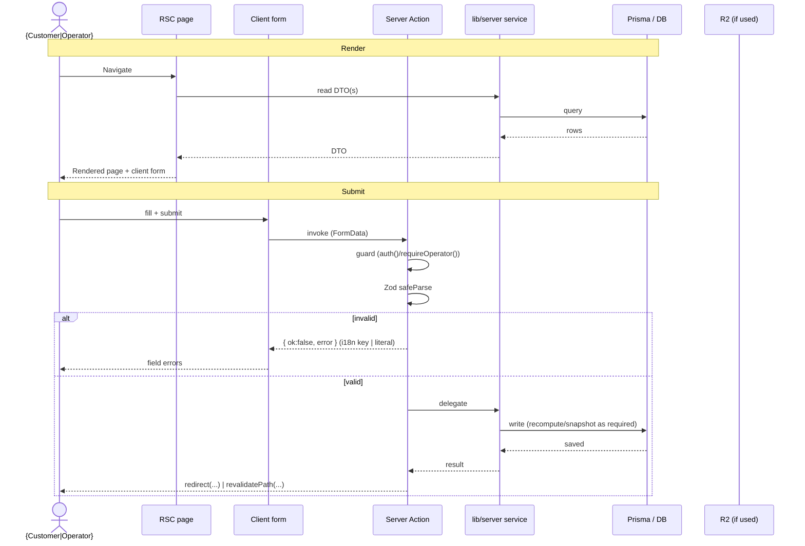

<!--
  STORY IMPLEMENTATION PLAN — GENERIC TEMPLATE
  ============================================
  Copy this file to  docs/plans/{epic}-{story}-{slug}.plan.md  and fill every section.

  Purpose: a house-style record of ONE story — what was designed, which layer owns which
  logic, and exactly which files/services were created — so the implementation is legible
  months later. Modelled on the BU-US-01 spec, re-mapped to THIS stack:

    Next.js 16 App Router · Server Actions · Prisma (lib/server only, AD-2) · next-intl · Cloudflare R2

  ID vocabulary used across the repo (see _bmad-output/):
    FR-*     Functional Requirements        (prd.md)
    AD-*     Architecture Decisions         (ARCHITECTURE-SPINE.md)
    AR-*     Architecture-derived reqs      (epics.md)
    UX-DR*   UX Design Requirements         (epics.md / DESIGN.md)
    Story {epic}.{story}                    (epics.md → file {epic}-{story}-slug.md)

  Delete every <!-- guidance --> comment as you fill the section in.
-->

# Story {epic}.{story}: {Story title}

> **Epic:** {n} · **FR:** {FR-x, FR-y} · **AD:** {AD-a, AD-b} · **Status:** {ready-for-dev | in-progress | Done — gates + runtime green} · **Branch:** `{branch}` · **Commit:** `{shorthash}`
> **Source story:** `_bmad-output/planning-artifacts/.../epics.md#story-{epic}{story}` · **Impl artifact:** `_bmad-output/implementation-artifacts/{epic}-{story}-{slug}.md`

<!-- guidance: one or two sentences — the user story ("As a … I want … so that …") and the outcome this story delivers. -->

**As a** {role}, **I want** {action}, **so that** {benefit}.

---

## 1. Gaps & Decisions (Resolved)

<!-- guidance: design-time questions that were settled BEFORE/DURING build. One row per decision.
     Area = Validation | Architecture | Data | UX | Security | Scope. Status is usually ✅ Resolved. -->

| ID | Area | Decision | Status |
|----|------|----------|--------|
| D1 | {area} | {what was decided and why} | ✅ Resolved |
| D2 | {area} | {…} | ✅ Resolved |

---

## 2. Architecture

### 2.1 Source-tree layout

<!-- guidance: every file this story touches, grouped by layer, with a one-line role comment.
     Mark (new) / (mod). This is the at-a-glance "what we built" map. -->

```text
prisma/
├── schema.prisma                                  # (mod) {models/enums added}
└── migrations/{timestamp}_{name}/migration.sql    # (new) {tables/enum created}

lib/
├── server/
│   ├── {aggregate}.ts                             # (new/mod) {service — key exports}
│   └── {other-service}.ts                         # (mod) {what changed}
├── validation/
│   └── {feature}-schemas.ts                       # (new) Zod schema(s) — i18n-key messages
└── format.ts                                      # (reused) formatVnd / pickLocalized

app/
└── [locale]/{feature}/                            # storefront   (or  app/admin/(app)/{feature}/)
    ├── page.tsx                                   # (new) RSC — read + render
    ├── actions.ts                                 # (new) "use server" — mutation boundary
    └── {feature}-form.tsx                         # (new) "use client" — form widget

components/
└── form/{field}.tsx                               # (new/reused) shared field component

messages/
├── en.json                                        # (mod) {Namespace} keys
└── vi.json                                        # (mod) {Namespace} keys (VN default+fallback)
```

### 2.2 Data model

<!-- guidance: Prisma models/enums added or changed + the migration folder. Omit if the story adds no schema. -->

| Model / Enum | Table | Key fields | Notes |
|--------------|-------|------------|-------|
| `{Model}` | `{table}` | `{fields, @unique, @@index}` | {aggregate root? soft FK? decomposed money? snapshot?} |

Migration: `prisma/migrations/{timestamp}_{name}/`. Run `npx prisma generate` after schema edits (tsc needs the regenerated client).

### 2.3 Layer responsibilities

<!-- guidance: who controls which logic for THIS story. This is our RSC/Action/service split
     (the analogue of Spring's thin-controller / service-owns-rules). -->

| Layer | Owns (for this story) | File(s) |
|-------|-----------------------|---------|
| RSC page | reads DTOs, renders; no mutation | `{page.tsx}` |
| Server Action (`"use server"`) | guard → Zod validate → delegate → revalidate/redirect | `{actions.ts}` |
| `lib/server` service | business rules + sole Prisma/R2 access (AD-2) | `{service.ts}` |
| Data access | Prisma singleton (PrismaPg → Supabase) | `lib/server/db.ts` |
| Storage | R2 public/private buckets | `lib/server/storage.ts` |

### 2.4 Business rules & invariants

<!-- guidance: each enforceable rule, its source ID, and the exact file that enforces it. -->

| Rule | Source | Enforced in |
|------|--------|-------------|
| {e.g. money recomputed server-side, never trust client total} | AD-10 | `lib/server/{service}.ts` |
| {e.g. digital variant qty forced to 1} | AD-8 | `lib/server/{service}.ts` |
| {e.g. input shape} | FR-x | `lib/validation/{feature}-schemas.ts` |
| {e.g. operator-only mutation} | AD-9 | `{actions.ts}` (`requireOperator()`) |

### 2.5 Sequence diagram

<!-- guidance: RSC render + Server Action submit. No CSRF-token step — Server Actions carry
     built-in protection; the auth/guard step stands in its place. alt-branch the result union. -->



### 2.6 Result / error flows

<!-- guidance: our Server Actions return a result UNION (not HTTP status codes). Storefront errors
     are i18n keys resolved client-side; admin errors are literal English strings. -->

| Scenario | Outcome | Where |
|----------|---------|-------|
| Validation fails | `{ ok: false, error: "{i18n.key | literal}" }` | `{actions.ts}` |
| Not authorized | `redirect("/admin/login")` / `redirect("/login")` | guard in action + layout |
| Not found | `notFound()` | `{page.tsx}` |
| Success | `redirect(...)` (flow) or `revalidatePath(...)` (stay) | `{actions.ts}` |

### 2.7 Convention compliance (AD / AR / UX-DR)

<!-- guidance: the decisions this story must honor and how. Keep to the relevant ones. -->

| Rule | Status | Note |
|------|--------|------|
| AD-2 — only `lib/server` imports Prisma | Required | {…} |
| AD-5 — integer VND end-to-end | Required | {…} |
| AD-7 — per-locale content, VN fallback | Required | {…} |
| {story-specific AD/AR/UX-DR} | Required | {…} |

### 2.8 Components & i18n keys

<!-- guidance: client components + reusable components/form/*, and the i18n namespace/keys added. -->

| Component | Kind | File |
|-----------|------|------|
| `{FormName}` | client | `{feature}-form.tsx` |
| `{FieldName}` | reused | `components/form/{field}.tsx` |

**i18n namespace `{Namespace}`** added to `messages/en.json` + `messages/vi.json`:
`{key1}`, `{key2}`, `{…}`

---

## 3. Tasks (checklist)

<!-- guidance: the pre-implementation checklist — review BEFORE coding. Check off as done. -->

| ID | Task | File |
|----|------|------|
| T01 | {schema + migration} | `prisma/…` |
| T02 | {service function(s)} | `lib/server/{service}.ts` |
| T03 | {Zod schema} | `lib/validation/{feature}-schemas.ts` |
| T04 | {RSC page} | `{page.tsx}` |
| T05 | {Server Action} | `{actions.ts}` |
| T06 | {client form} | `{feature}-form.tsx` |
| T07 | {i18n keys en + vi} | `messages/{en,vi}.json` |

- [ ] T01 [ ] T02 [ ] T03 [ ] T04 [ ] T05 [ ] T06 [ ] T07

---

## 4. Verification

<!-- guidance: the project's real gates + runtime. Record what actually passed. -->

- **Static gates:** `npx tsc --noEmit` · `npx eslint .` · `npm run build` — all green.
- **Runtime:** {browser walk | cookie-jar curl of the flow} — {what was checked}.
- **R2-live** (if storage touched): {upload/preview/public-URL confirmed}.

---

## 5. Dev Agent Record — File List

<!-- guidance: the post-implementation inventory — "what we actually built/changed". -->

| File | Created / Modified | Role |
|------|--------------------|------|
| `{path}` | Created | {one-line role} |
| `{path}` | Modified | {what changed} |

**Not in scope (later stories):** {deferred items → which story}.
